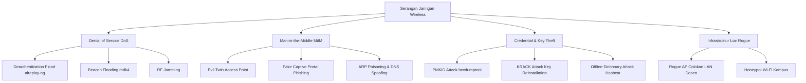

# MATERI KULIAH: SERANGAN NIRKABEL MODERN & ARSITEKTUR KEAMANAN ENTERPRISE
**Mata Kuliah:** Sistem Komunikasi Nirkabel (3 SKS)  
**Program Studi:** Teknologi Rekayasa Komputer (TRK) - Politani  
**Dosen Pengampu:** M. Riza Nurtam, M.Kom  
**Pertemuan:** Minggu X (Pertemuan 2 Modul Keamanan)  
**Alokasi Waktu:** 210 Menit (3 x 70 menit)  
**Dokumen Pendamping:** `Bacaan_Mahasiswa_Keamanan_Nirkabel.docx`, `Catatan_Dosen_Keamanan_Nirkabel.docx`, `Slide_Keamanan_Nirkabel.pptx`

---

## RUNDOWN & RENCANA WAKTU PEMBELAJARAN (TOTAL: 210 MENIT)

| Sesi | Waktu | Aktivitas Pembelajaran | Fokus Praktisi / Engineer |
| :--- | :---: | :--- | :--- |
| **Sesi 1** | 00:00 - 00:35 (35m) | **Review Pertemuan 1 & Taksonomi Serangan Nirkabel**<br>- Review kritis: PMK, PTK, dan celah offline cracking 4-Way Handshake.<br>- Mengapa enkripsi AES saja tidak cukup? (Kriptografi kuat runtuh jika protokol sekitar cacat).<br>- Taksonomi serangan: Eavesdropping, Man-in-the-Middle (MitM), Denial of Service (DoS), dan Credential Theft. | Membangun paradigma keamanan berlapis (*defense-in-depth*). |
| **Sesi 2** | 00:35 - 01:25 (50m) | **Eksploitasi Frame Manajemen & Rogue Access Point**<br>- **Deauthentication Flooding:** Mengapa frame manajemen 802.11 tidak terenkripsi? Mekanisme pemutusan paksa via `aireplay-ng`.<br>- **Rogue Access Point:** Bahaya backdoor colokan LAN internal tanpa firewall.<br>- **Evil Twin Attack:** Mengubah interface ke Master mode (`hostapd`), kloning SSID/BSSID, pemutusan klien dari AP sah, dan pemanenan kredensial via Captive Portal Phishing. | Bedah struktur serangan aktif yang paling sering menyerang kampus/kantor. |
| **Sesi 3** | 01:25 - 01:45 (20m) | *Istirahat & Diskusi Interaktif Sesi 1* | Tanya jawab penanganan insiden phishing Wi-Fi. |
| **Sesi 4** | 01:45 - 02:35 (50m) | **Serangan Lanjutan & Arsitektur WPA-Enterprise (802.1X)**<br>- **KRACK Attack (2017):** Manipulasi instalasi ulang kunci pada Message 3 (reset nonce $\rightarrow$ keystream replay).<br>- **PMKID Attack (2018):** Penangkapan hash tanpa menunggu klien terhubung (*clientless attack*).<br>- **Arsitektur IEEE 802.1X:** Mengapa Pre-Shared Key (PSK) tidak layak di enterprise?<br>- Peran Supplicant, Authenticator (AP/Switch), dan Authentication Server (FreeRADIUS).<br>- Komparasi Metode EAP: **EAP-TLS** (Sertifikat Digital) vs **PEAP-MSCHAPv2** (Username/Password). | Solusi otentikasi terpusat untuk jaringan skala besar. |
| **Sesi 5** | 02:35 - 03:10 (35m) | **Sistem Pertahanan, WIDS/WIPS, & Hardening WLAN**<br>- **Protected Management Frames (PMF / IEEE 802.11w):** Enkripsi frame manajemen untuk menolak deauth palsu.<br>- **WIDS / WIPS:** Sensor 24/7 untuk melacak Rogue AP dan mitigasi penahanan liar (*Rogue Containment*).<br>- **Blueprint Segmentasi Kampus:** Pemisahan SSID/VLAN (Dosen, Mahasiswa, Tamu), Client Isolation (`default-forwarding=no`), dan Firewall Drop Inter-VLAN. | Panduan konfigurasi hardening router di dunia industri. |
| **Sesi 6** | 03:10 - 03:30 (20m) | **Rangkuman, Refleksi, & Briefing Praktikum Lab** | Kesimpulan komprehensif modul keamanan, pengantar simulasi lab hardening. |

---

## 1. MENGAPA ENKRIPSI AES SAJA TIDAK CUKUP?

Pada Pertemuan 1, kita mempelajari bahwa algoritma **AES-128** secara matematis belum pernah berhasil dipecahkan sejak disahkan NIST tahun 2001. Namun, **keamanan sistem nirkabel bukan hanya tentang algoritma AES**:
- Ada protokol pertukaran kunci (4-Way Handshake).
- Ada manajemen kunci dinamis (PMK, PTK, GTK).
- Ada integritas paket data (MIC).
- Ada frame kontrol dan manajemen (Beacon, Probe, Deauth).

Jika protokol dan arsitektur di sekitar AES memiliki celah, penyerang tidak perlu bersusah payah membobol AES. Penyerang cukup menyerang titik terlemah dalam rantai sistem (*weakest link in the chain*).



---

## 2. BEDAH MEKANISME SERANGAN AKTIF

### 2.1 Deauthentication Flooding Attack (Eksploitasi 802.11 Non-PMF)
- Standar IEEE 802.11 konvensional (WPA/WPA2 tanpa 802.11w) hanya mengenkripsi data payload. Seluruh frame manajemen dan kontrol dikirimkan dalam format **plaintext tanpa otentikasi keaslian sumber**.
- **Alur Eksekusi Serangan:**
  1. Penyerang menyalakan kartu nirkabel ke **Monitor Mode**.
  2. Mengidentifikasi MAC Address AP target (BSSID) dan MAC Address smartphone korban (STA).
  3. Menggunakan tool `aireplay-ng`, penyerang membuat dan mengirimkan puluhan frame Deautentikasi palsu dengan memalsukan (*spoofing*) Source MAC seolah-olah dikirim oleh AP resmi:
     ```bash
     sudo aireplay-ng --deauth 10 -a <BSSID_AP> -c <MAC_KORBAN> wlan0mon
     ```
  4. Kartu jaringan korban menerima frame deauth tersebut. Karena tidak ada enkripsi/tanda tangan digital, kartu korban wajib mematuhi protokol dan **langsung memutuskan koneksi secara instan**.
- **Tujuan Ganda Penyerang:**
  1. *Denial of Service (DoS):* Melumpuhkan koneksi korban terus-menerus.
  2. *Handshake Capture:* Memaksa korban reconnect otomatis agar penyerang dapat merekam 4-Way Handshake di udara.

---

### 2.2 Rogue AP vs Evil Twin Attack

```
   [ AP RESMI KAMPUS ]                                       [ LAPTOP PENYERANG ]
   SSID: POLITANI-FREE                                      SSID: POLITANI-FREE (Tiruan)
   MAC: 00:11:22:33:44:01                                   MAC: 00:11:22:33:44:01 (Spoofed)
   Kanal 6 (Sinyal Normal)                                  Kanal 6 (Sinyal Dikuatkan!)
           |                                                         |
           |                                                         |
           X (( Diserang Deauth Flood! ))                            |
           X                                                         |
           |                                                         |
     [ KLIEN MAHASISWA ] <===========================================+
      (Terputus dari AP Resmi, lalu Roaming otomatis ke Evil Twin karena sinyal lebih kuat!)
                             |
                             v
             [ Halaman Login Captive Portal Palsu ]
             (Kredensial Username & Password Tercuri)
```

1. **Rogue Access Point (Ancaman dari Dalam):**
   - Perangkat Access Point fisik tidak sah yang dipasang diam-diam oleh staf, dosen, atau mahasiswa ke port colokan kabel LAN kampus (misal memasang router mini rumahan agar dapat Wi-Fi di ruang kerja).
   - *Bahaya:* Router mini ini biasanya tidak dikonfigurasi dengan aman, tanpa firewall, dan mem-bypass seluruh sistem proteksi sentral kampus, menjadi pintu belakang (*backdoor*) bagi penyerang luar.
2. **Evil Twin Attack (Ancaman Penyamaran):**
   - Penyerang menyalakan kartu nirkabel ke **Master Mode** menggunakan software seperti `hostapd-mana` atau `wifiphisher`.
   - Membuat access point tiruan dengan SSID dan BSSID yang persis sama dengan Wi-Fi resmi kampus.
   - Penyerang menembakkan deauth flood ke AP resmi sehingga pengguna terlempar keluar.
   - Karena perangkat smartphone modern secara alami akan mencari dan terhubung ke sinyal terkuat dengan SSID yang sama, korban otomatis terhubung ke Evil Twin milik penyerang.
   - Penyerang menyajikan halaman login web (*Captive Portal*) tiruan yang meminta username/password SIAKAD mahasiswa.

---

### 2.3 Serangan Lanjutan: KRACK & PMKID

#### A. KRACK Attack (Key Reinstallation Attack - 2017)
- Ditemukan oleh peneliti Mathy Vanhoef. Serangan ini **tidak membobol algoritma AES**, melainkan mengeksploitasi logika state-machine pada **Message 3 dari 4-Way Handshake**.
- Saat AP mengirimkan Message 3 (perintah install PTK), penyerang menahan frame konfirmasi ACK Message 4 dari klien.
- AP mengira pesannya hilang, lalu mengirim ulang Message 3.
- Ketika klien menerima Message 3 berulang, standar 802.11 yang cacat memerintahkan kartu jaringan untuk **menginstal ulang PTK yang sama dan mereset nilai packet counter / Nonce kembali ke nol (0)**!
- *Konsekuensi:* Kunci yang sama dipakai dengan Nonce yang kembali ke nol $\rightarrow$ terjadi pengulangan keystream pada AES-CCMP $\rightarrow$ penyerang dapat mendekripsi dan merekayasa paket data!

#### B. Serangan PMKID (Clientless Attack - 2018)
- Penyerang tidak perlu menunggu ada klien yang terhubung ke jaringan target.
- Pada router yang mengaktifkan fitur *fast roaming* (IEEE 802.11r), AP menyertakan nilai **PMKID (Pairwise Master Key Identifier)** pada frame Message 1 begitu menerima satu frame *Association Request* dari penyerang.
- Penyerang langsung mendapatkan hash PMKID tanpa perlu melakukan deauth terhadap pengguna sah.

---

## 3. ARSITEKTUR WPA-ENTERPRISE (IEEE 802.1X)

Untuk skala kampus atau korporasi, penggunaan kata sandi tunggal bersama (*Pre-Shared Key*) memiliki kelemahan fatal: jika satu orang membocorkan kata sandi, seluruh jaringan terancam dan admin harus mengganti kata sandi di ratusan perangkat.

```
+--------------------+        EAPoL         +--------------------+        RADIUS        +--------------------+
|     SUPPLICANT     | <==================> |   AUTHENTICATOR    | <==================> |   AUTHENTICATION   |
| (Perangkat Klien)  | (Over-the-Air Link)  | (Access Point/WLC) | (Kabel LAN Backend)  |       SERVER       |
|  Laptop Mahasiswa  |                      |  MikroTik / Ruijie |                      |    (FreeRADIUS)    |
+--------------------+                      +--------------------+                      +---------+----------+
                                                                                                  |
                                                                                        +---------v----------+
                                                                                        | DATABASE PENGGUNA  |
                                                                                        | (Active Directory/ |
                                                                                        |  LDAP Mahasiswa)   |
                                                                                        +--------------------+
```

### 3.1 Tiga Komponen Utama IEEE 802.1X:
1. **Supplicant:** Software agen otentikasi pada perangkat pengguna (laptop/HP).
2. **Authenticator:** Access Point yang bertindak sebagai gerbang (*gatekeeper*). Port data klien diblokir (*controlled port*), dan AP hanya meneruskan paket otentikasi EAP ke server backend.
3. **Authentication Server (RADIUS):** Server pusat (seperti *FreeRADIUS* atau *Microsoft Network Policy Server*) yang memvalidasi keabsahan akun pengguna ke database LDAP / SIAKAD kampus.

### 3.2 Komparasi Metode EAP (Extensible Authentication Protocol):
- **EAP-TLS (Tingkat Keamanan Tertinggi):**
  - Menggunakan sertifikat digital X.509 pada server RADIUS **dan** pada perangkat klien.
  - Sangat kebal terhadap pencurian kata sandi karena tidak menggunakan password sama sekali.
  - Sangat cocok untuk laptop dinas pimpinan atau server akademik.
- **PEAP-MSCHAPv2 (Paling Populer untuk Kampus):**
  - Hanya server RADIUS yang memasang sertifikat digital untuk membuat tunnel terenkripsi (TLS).
  - Mahasiswa cukup login menggunakan username dan password SIAKAD masing-masing di dalam tunnel yang aman tersebut.
  - Jika seorang mahasiswa lulus atau staf berhenti, admin cukup mematikan akunnya di database sentral tanpa perlu mengubah konfigurasi Wi-Fi di seluruh kampus!

---

## 4. SISTEM PERTAHANAN & HARDENING WLAN ENTERPRISE

### 4.1 Protected Management Frames (IEEE 802.11w / PMF)
- Standar wajib pada WPA3 dan opsional pada WPA2.
- Mengenkripsi dan menandatangani frame manajemen (Deauthentication, Disassociation, Robust Action Frames) menggunakan protokol kriptografi **BIP (Broadcast Integrity Protocol)**.
- Ketika penyerang menembakkan frame deauth palsu menggunakan `aireplay-ng`, AP dan stasiun yang mengaktifkan PMF akan langsung **menolak dan mengabaikan frame palsu tersebut** karena tidak memiliki tanda tangan digital yang sah. Serangan pemutusan massal gagal total!

### 4.2 Wireless Intrusion Detection & Prevention System (WIDS/WIPS)
- Menggunakan sensor radio nirkabel dedicated yang terus memindai spektrum udara selama 24 jam penuh.
- **Deteksi Otomatis (WIDS):** Mendeteksi kemunculan Rogue AP yang dicolokkan ke switch internal, Evil Twin AP tiruan, serta pemancar jamming.
- **Mitigasi Otomatis (WIPS):** Sistem mengirimkan frame penahanan (*Rogue Containment*) untuk mencegah mahasiswa/staf terhubung ke access point liar tersebut.

### 4.3 Blueprint Segmentasi WLAN Kampus Politani

| SSID Name | VLAN ID | Metode Otentikasi | Fitur Hardening Wajib | Peruntukan Akses |
| :--- | :---: | :--- | :--- | :--- |
| `POLITANI-STAFF` | VLAN 10 | WPA2/WPA3 Enterprise (PEAP) | PMF Required, Akses Intranet & SIAKAD Dosen | Dosen & Pegawai Resmi |
| `POLITANI-MHS` | VLAN 20 | WPA2 Enterprise / RADIUS | Bandwidth Quota per user, Peer-to-Peer Blocked | Mahasiswa Aktif Kampus |
| `POLITANI-GUEST` | VLAN 30 | Captive Portal Web | **Client Isolation ON**, Firewall Drop ke Subnet Internal | Tamu & Pengunjung Luar |

> [!TIP]
> **Fungsi Client Isolation (`default-forwarding=no`):**
> Pada jaringan publik/tamu, fitur ini memblokir komunikasi langsung antar-stasiun nirkabel. Pengguna di kafe/taman hanya boleh berkomunikasi ke Gateway internet dan tidak bisa saling memindai port (*port scanning*), menyadap paket (*ARP Poisoning*), atau menyebarkan malware ke laptop pengguna lain di sebelahnya.
